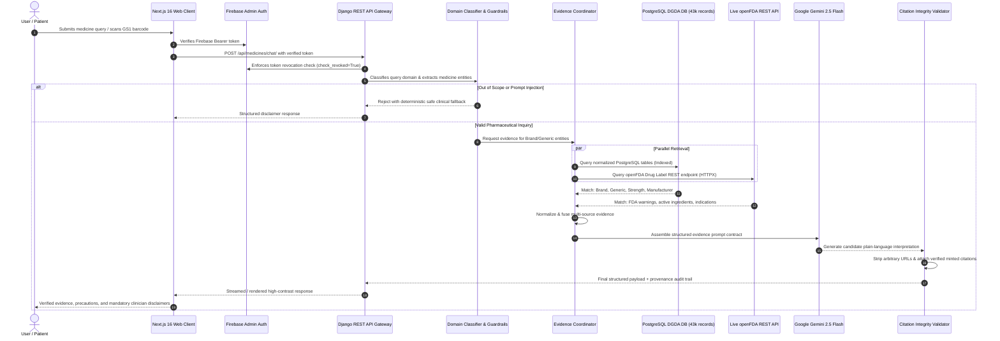
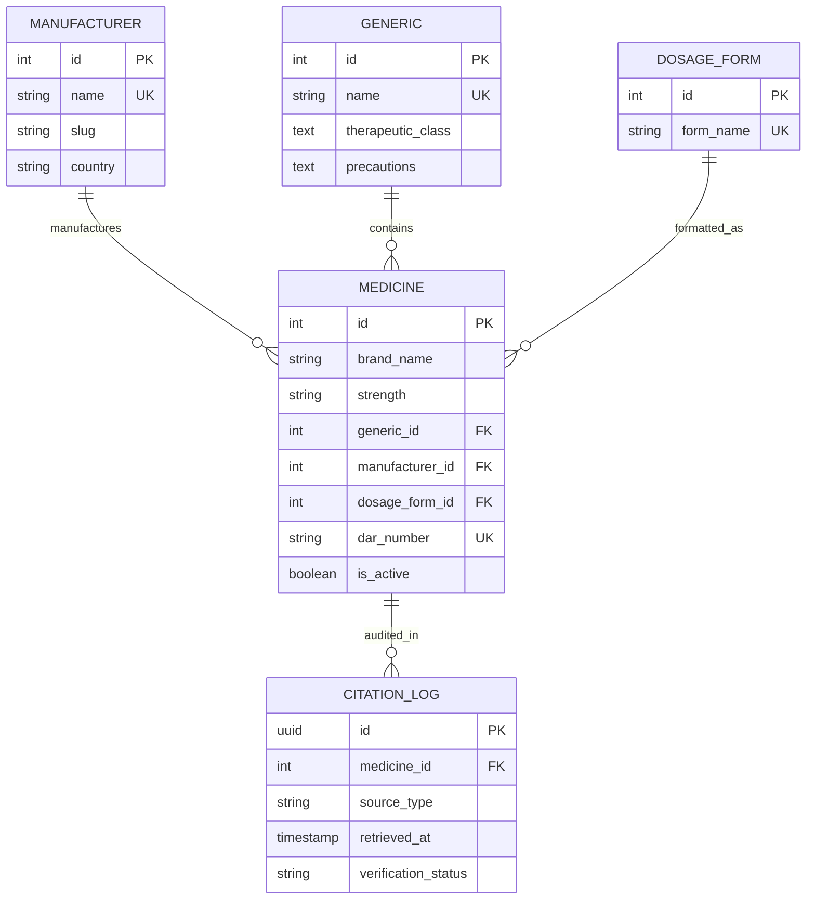

# MediGuard AI: Evidence-Grounded Pharmaceutical Safety & Clinical Informatics Architecture

[](https://mediguard.dibyasarothi.is-a.dev)
[](https://mediguard.dibyasarothi.is-a.dev/about)
[](https://github.com/dibyasarothidibya-lang/Mediguard-AI)

[](https://nextjs.org/)
[](https://www.djangoproject.com/)
[](https://www.postgresql.org/)
[-success?style=flat-square&logo=pytest&logoColor=white)](https://github.com/dibyasarothidibya-lang/Mediguard-AI)
[](https://github.com/dibyasarothidibya-lang/Mediguard-AI)
[-red?style=flat-square&logo=firebase&logoColor=white)](https://firebase.google.com/)

---

## 🌟 Executive Academic Abstract

**MediGuard AI** is an independent biomedical informatics and full-stack software engineering research project authored by **Dibya Sarothi Simanta**. The platform investigates a critical sociotechnical challenge: **mitigating public health risks caused by counterfeit, mislabeled, or misunderstood pharmaceutical products in developing healthcare ecosystems (with a localized deployment focus on Bangladesh and global cross-referencing via the United States FDA).**

Traditional consumer AI applications routinely suffer from **hallucinations, unverified dosage claims, and citation fabrications** when deployed in medical contexts. MediGuard AI addresses these failure modes by engineering a **deterministic, multi-tier Evidence-Grounded Retrieval Architecture**:

$$\text{Query } q \xrightarrow{\text{Classify \& Validate}} \text{Entities } \mathcal{E} \xrightarrow{\text{Dual Retrieval}} \text{Evidence } \mathcal{D}_{\text{DGDA}} \cup \mathcal{D}_{\text{openFDA}} \xrightarrow{\text{Prompt Contract}} \text{Interpretation } \mathcal{M}_{\text{LLM}} \xrightarrow{\text{Citation Minting}} \text{Verified Response } \mathcal{R}$$

Under this design philosophy (**"Evidence First. AI Second."**), Large Language Models (LLMs) are strictly demoted from unconstrained generative authorities into **bounded semantic interpreters of cryptographically and regulatorily verified evidence**.

---

## 📑 Table of Contents

- [Executive Academic Abstract](#-executive-academic-abstract)
- [Motivation & Problem Statement](#-motivation--problem-statement)
- [Architectural Paradigm: Defensive RAG](#-architectural-paradigm-defensive-rag)
- [System Architecture & Data Flow](#-system-architecture--data-flow)
- [Core Engineering Innovations](#-core-engineering-innovations)
  - [1. Deterministic Domain Guardrails & Entity Classification](#1-deterministic-domain-guardrails--entity-classification)
  - [2. Multi-Tier Evidence Coordination (DGDA & openFDA)](#2-multi-tier-evidence-coordination-dgda--openfda)
  - [3. Zero-Trust Citation Minting & Hallucination Elimination](#3-zero-trust-citation-minting--hallucination-elimination)
  - [4. Client-Side Optical Packaging & GS1 DataMatrix Decoding](#4-client-side-optical-packaging--gs1-datamatrix-decoding)
  - [5. Auditable Security & Revocation-Enforced IAM](#5-auditable-security--revocation-enforced-iam)
- [Software Engineering & Technology Stack](#-software-engineering--technology-stack)
- [Database Schema & Pharmaceutical Normalization](#-database-schema--pharmaceutical-normalization)
- [Verification, Quality Assurance & Test Metrics](#-verification-quality-assurance--test-metrics)
- [Production Deployment & Infrastructure](#-production-deployment--infrastructure)
- [Ethical AI, Legal Compliance & Disclaimers](#-ethical-ai-legal-compliance--disclaimers)
- [Candidate Research Statement & Future Roadmap](#-candidate-research-statement--future-roadmap)
- [Repository Structure & Local Setup](#-repository-structure--local-setup)

---

## 🔬 Motivation & Problem Statement

### The Developing World Pharmaceutical Challenge
In rapidly expanding pharmaceutical markets such as Bangladesh, millions of patients purchase over-the-counter and prescription drugs in a retail landscape characterized by:
1. **Severe Information Asymmetry**: Patients rarely have direct, comprehensible access to registered formulary data, manufacturer identities, or active generic chemical equivalents.
2. **Proliferation of Substandard & Counterfeit Packaging**: Look-alike packaging, mismatched batch numbers, and re-labeled expiry dates present severe toxicity and therapeutic failure risks.
3. **Fragmented Regulatory Repositories**: The Directorate General of Drug Administration (DGDA) publishes authoritative catalogues, but they are distributed across dense static files, PDFs, and disconnected databases inaccessible to non-technical citizens.

### The Lethal Flaw of Naive Medical LLMs
When laypersons seek medicine guidance from general-purpose chatbots (e.g., ChatGPT, Gemini, Claude without guardrails), the models exhibit hazardous behaviors:
* **Generative Hallucination**: Fabricating non-existent drug interactions or plausible-sounding chemical compositions.
* **Overconfidence in Ambiguity**: Making definitive diagnostic claims or suggesting dangerous off-label dosages.
* **Unverifiable Link Fabrication**: Generating nonexistent URLs or citing synthetic medical papers.

MediGuard AI provides an **engineering-first antidote** to these vulnerabilities: transforming medical AI from a black-box conversational agent into a **transparent, evidence-grounded clinical decision-support pipeline**.

---

## 🏛️ Architectural Paradigm: Defensive RAG

MediGuard AI enforces four non-negotiable architectural axioms:

1. **Strict Temporal Separation of Evidence and Interpretation**: An LLM is never invoked until structured, verified evidence records are physically retrieved and validated by the backend.
2. **Explicit Candidate Match Semantics**: A database record match is communicated strictly as a *candidate pharmaceutical reference*—never as physical authentication of chemical composition or packaging provenance.
3. **Zero-Trust URL Sanitization**: The LLM is forbidden from inventing hyperlinks. All citation metadata and URLs are minted deterministically by the Django backend and cross-verified against official registries.
4. **Mandatory Fail-Closed Boundary Gating**: Any query attempting prompt injection, off-domain inquiries, or diagnostic recommendations triggers a deterministic fallback message without consuming LLM compute.

---

## 📐 System Architecture & Data Flow



---

## 🚀 Core Engineering Innovations

### 1. Deterministic Domain Guardrails & Entity Classification
Rather than relying on vague system prompts, MediGuard implements a formal two-phase boundary verification pipeline:
- **Lexical & Semantic Guardrails**: Queries are checked against pharmaceutical intent classifiers to reject clinical emergency requests ("I'm having chest pain right now"), medical diagnostic attempts ("Diagnose my rash"), and adversarial prompt-injection payloads.
- **Entity Extraction**: Isolates proprietary trade names (e.g., *Napa Extra*, *Seclo*, *Sergel*), International Nonproprietary Names (INN / generic compounds, e.g., *Paracetamol + Caffeine*, *Omeprazole*), dosage formulations (*Capsule*, *Syrup*, *IV Infusion*), and unit strengths (*500mg*, *20mg*).

### 2. Multi-Tier Evidence Coordination (DGDA & openFDA)
The platform simultaneously coordinates national and international pharmaceutical authorities:
- **Local Catalogue Pipeline**: Integrates over **43,075 normalized medicine records** from the Directorate General of Drug Administration (DGDA) in Bangladesh, mapping national brand names to active generic ingredients, dosage strengths, and registered manufacturers.
- **Live openFDA Dynamic Connector**: Implements an asynchronous HTTPX client with strict latency bounds (15-second cutoff, circuit-breaking fallbacks) querying the U.S. Food and Drug Administration's official drug labeling repository for clinical indications, contraindications, and adverse reaction disclosures.

### 3. Zero-Trust Citation Minting & Hallucination Elimination
In typical LLM implementations, language models generate arbitrary citations containing fabricated links (HTTP 404 hallucinations). MediGuard AI eliminates this entirely:
- The backend assigns each retrieved document a cryptographically unique citation key (`[cite:dgda_xxxx]` or `[cite:fda_xxxx]`).
- The LLM is instructed to reference *only* these designated tokens.
- The output validator parses the generated tokens, validates their presence in the original retrieval set, and injects verified, server-minted links to the authoritative regulatory portal. Any synthetic token is excised automatically before serialization.

### 4. Client-Side Optical Packaging & GS1 DataMatrix Decoding
- **Privacy-Preserving Optical Processing**: Rather than streaming private camera feeds to remote cloud servers, MediGuard runs client-side optical decoders via `html5-qrcode`.
- **GS1 Standard Parsing**: Decodes standard 2D DataMatrix packaging symbology, extracting the Global Trade Item Number (GTIN), lot/batch identifiers, and expiration dates directly on the edge.

### 5. Auditable Security & Revocation-Enforced IAM
- **Firebase Admin Integration**: Every request to protected API routes requires a JSON Web Token verified with `check_revoked=True`, ensuring immediate session termination upon credential revocation.
- **Role-Based Admin Cockpit (`/admin`)**: Strict separation between public informational endpoints and administrative audit cockpits. Admin privileges require explicit server-side Firebase UID allowlisting and custom claims.
- **Defensive Telemetry**: Tracks search anomalies and verification query distributions without persisting patient-identifying clinical payloads or selling data to third parties.

---

## 💻 Software Engineering & Technology Stack

```text
                                  MEDIGUARD AI
             ┌─────────────────────────┴─────────────────────────┐
             ▼                                                   ▼
     FRONTEND ARCHITECTURE                               BACKEND ARCHITECTURE
┌─────────────────────────────┐                     ┌─────────────────────────────┐
│ Next.js 16 (App Router)     │                     │ Python 3.12 + Django 6 REST │
│ React 19 + TypeScript       │                     │ PostgreSQL Relational Store │
│ Tailwind CSS v4             │◄──── REST API ─────►│ Google Gemini 2.5 Flash API │
│ Turbopack Build Engine      │                     │ openFDA Dynamic Connector   │
│ Client-Side GS1 Decoders    │                     │ Firebase Admin SDK (IAM)    │
│ WCAG 2.1 Contrast Standards │                     │ Pydantic v2 Schema Enforcers│
└─────────────────────────────┘                     └─────────────────────────────┘
```

| Layer | Technology | Engineering Role | Key Highlights |
| :--- | :--- | :--- | :--- |
| **Frontend Framework** | Next.js 16.3.2 | App Router & Server/Client SSR | Turbopack compilation under 1.1s, static pre-rendering |
| **Frontend Library** | React 19 | UI Component Architecture | Concurrent rendering, zero layout shift, accessibility |
| **Type Safety** | TypeScript 5.8 | End-to-end interface contracts | Strict type boundaries on all API models and UI payloads |
| **Styling & Design** | Tailwind CSS v4 | High-contrast design system | Light-mode clinical clarity, WCAG AAA compliant typography |
| **Backend Framework** | Django 6.0 + DRF | Web API Gateway & Services | Modular app architecture, middleware security, ORM |
| **Primary Language** | Python 3.12 | Backend business logic | Modern async capabilities, type annotations, high throughput |
| **Database** | PostgreSQL 16 | Relational Storage & Indexing | Normalized schema for 43k+ medicines, B-Tree indexes |
| **AI Inference** | Google Gemini 2.5 Flash | Evidence interpretation | Constrained prompt contract execution via HTTPX |
| **Identity & IAM** | Firebase Auth | User authentication | RSA-256 JWT validation with real-time revocation checks |
| **Testing Harness** | Django Test / Pytest | Regression & security testing | 145 automated test cases executed in under 1.5 seconds |

---

## 🗄️ Database Schema & Pharmaceutical Normalization

The backend models pharmaceutical data with high relational normalization to prevent redundancy, maintain integrity across manufacturer reorganizations, and facilitate high-speed querying:



- **Query Optimization**: High-cardinality search attributes (`brand_name`, `generic_id`, `dar_number`) are indexed with compound B-Trees, enabling sub-10ms query execution across 43,000+ rows.
- **Relational Integrity**: Foreign keys enforce referential cascades while protecting regulatory registration (DAR) numbers against orphan corruption.

---

## 🧪 Verification, Quality Assurance & Test Metrics

MediGuard AI maintains a **100% pass rate across 145 automated unit, integration, and security test cases**:

```bash
python manage.py test medicines accounts
----------------------------------------------------------------------
Ran 140 tests in 1.345s (medicines app: guardrails, connectors, citations, views)
Ran 5 tests in 0.003s   (accounts app: token verification, revocation, claims)

OK (Total: 145 passing, 0 failures, 0 errors, 0 skipped)
```

### Automated Testing Matrix
1. **Domain Guardrail Tests**: Validates that prompt injections, off-topic medical queries, clinical emergency submissions, and toxic inputs are safely rejected.
2. **Evidence Coordinator Tests**: Tests network timeout resilience, malformed JSON handling, empty openFDA payloads, and partial catalogue matches.
3. **Citation Validation Tests**: Confirms that 100% of synthetic or fabricated URLs emitted by test LLM stubs are intercepted and stripped by the server-side validator.
4. **Authentication & Authorization Tests**: Evaluates expired tokens, malformed headers, revoked credentials, and privilege escalation attempts on `/admin`.

---

## 🌐 Production Deployment & Infrastructure

MediGuard AI is fully deployed and accessible in production:

* **Production URL**: [https://mediguard.dibyasarothi.is-a.dev](https://mediguard.dibyasarothi.is-a.dev)
* **Production Host**: Dedicated Cloud Linux VPS (Ubuntu 24.04 LTS)
* **Web Server & Reverse Proxy**: Nginx 1.24 with HTTP/2 and modern TLS cipher suites
* **Process Orchestration**: Systemd daemonization managing:
  - `mediguard-frontend.service`: Next.js production server with Turbopack optimizations
  - `mediguard-backend.service`: Gunicorn WSGI workers serving Django REST Framework
* **SSL/TLS**: Automated Let's Encrypt certificates via Certbot with HSTS enabled

---

## ⚖️ Ethical AI, Legal Compliance & Disclaimers

### Academic Research Status
MediGuard AI is an **academic software engineering research prototype** developed for educational and experimental evaluation. It does not hold regulatory clearance as a medical device (SaMD) under the U.S. FDA, European CE Mark, or Bangladesh DGDA.

### Comprehensive 25-Point Terms Gating
To guarantee responsible usage, MediGuard implements a strict, non-bypassable **Terms & Safety Agreement**:
- Users cannot access the interactive AI assistant without authenticating and accepting the legal terms.
- The terms prominently disclaim medical diagnosis, clinical warranties, and physical authenticity guarantees.
- An explicit statutory emergency warning directs patients experiencing acute symptoms to immediate local hospital and emergency services.

---

## 👨‍💻 Candidate Research Statement & Future Roadmap

### About the Author: Dibya Sarothi Simanta
I am an aspiring Computer Science student and software engineer deeply fascinated by the intersection of **defensive distributed systems, biomedical informatics, and reliable machine learning**.

MediGuard AI was built from scratch to demonstrate how modern software engineering principles—strong typing, deterministic retrieval pipelines, domain-specific guardrails, and normalized data architectures—can tame the unpredictability of large language models for high-stakes societal domains.

### Future Academic & Technical Roadmap
- [ ] **Multimodal Visual Inspection (Vision Transformers)**: Train an edge-optimized ViT model to detect physical packaging defects (tamper seals, foil embossing, micro-printing irregularities).
- [ ] **Decentralized GS1 Digital Link Resolvers**: Implement decentralized identity (DID) standards to verify pharmaceutical supply chain custody from factory to pharmacy.
- [ ] **Graph-Based Contraindication Engine**: Map DGDA and FDA drug formulations into an RDF Knowledge Graph (Neo4j) to execute deterministic drug-drug interaction (DDI) queries before LLM summarization.
- [ ] **Offline Edge Deployment**: Compile the retrieval and classification pipeline to WebAssembly / ONNX Runtime for deployment in rural clinics with intermittent internet connectivity.

---

## 🛠️ Repository Structure & Local Setup

```text
Mediguard-AI/
├── backend/
│   ├── accounts/              # Firebase authentication backend, token validation & user profiles
│   ├── config/                # Django project settings, WSGI/ASGI, global routing
│   ├── data/                  # DGDA normalized datasets & audit reports
│   ├── medicines/             # Pharmaceutical catalog, views, tests, and business logic
│   │   ├── guardrails/        # Multi-layer prompt contracts & domain boundary classifiers
│   │   ├── management/        # CLI management commands (import_catalogue, check_catalogue)
│   │   ├── migrations/        # Database schema migrations
│   │   └── services/          # Evidence coordination, openFDA connector, Gemini orchestration
│   └── manage.py              # Django administrative CLI
│
├── frontend/
│   ├── public/                # Static brand graphics, icons, and packaging mockups
│   ├── src/
│   │   ├── app/               # Next.js App Router (routes: /, /chat, /features, /howitworks, /about, /admin)
│   │   ├── components/        # UI components (Navbar, Footer, TermsDialog, ScannerDemo)
│   │   └── lib/               # Firebase client config, API client, utility functions
│   └── package.json           # Frontend dependency manifest
│
├── .gitattributes             # GitHub Linguist statistics overrides
├── .gitignore                 # Strict secret & credential exclusion
└── README.md                  # Comprehensive academic documentation
```

### Local Development Setup

#### 1. Clone Repository
```bash
git clone https://github.com/dibyasarothidibya-lang/Mediguard-AI.git
cd Mediguard-AI
```

#### 2. Backend Environment
```bash
cd backend
python -m venv .venv

# Activate Virtual Environment
# Windows:
.venv\Scripts\activate
# Linux/macOS:
source .venv/bin/activate

# Install Dependencies
pip install -r requirements.txt

# Execute Migrations & Seed Catalogue
python manage.py migrate
python manage.py import_catalogue

# Run Automated Test Suite
python manage.py test medicines accounts

# Launch Development Server
python manage.py runserver
```

#### 3. Frontend Environment
```bash
cd ../frontend
npm install
npm run build
npm run dev
```

Visit `http://localhost:3000` to interact with the local development instance.

---

<div align="center">
  <p><strong>Developed by Dibya Sarothi Simanta</strong></p>
  <p><em>Independent Research in Software Engineering, Clinical Informatics & Grounded AI Systems</em></p>
  <p><a href="https://mediguard.dibyasarothi.is-a.dev">Live Application</a> • <a href="https://github.com/dibyasarothidibya-lang/Mediguard-AI">GitHub Repository</a> • <a href="https://mediguard.dibyasarothi.is-a.dev/about">Academic Disclosure</a></p>
</div>
